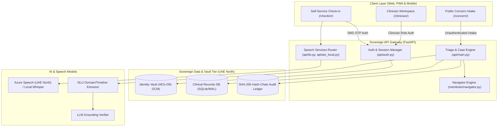
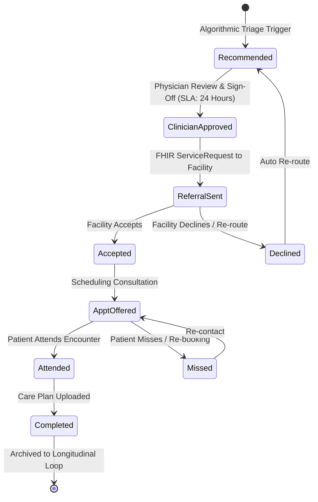

# MEMBRAIN: Comprehensive Technical Documentation & Clinical Essay

**A Concern-First, AI-Enabled Platform for Identifying Cognitive and Functional Change, Understanding Brain-Health Risks, and Connecting People to Timely, Personalised Care**

* **Challenge:** Future Health Digital Innovation Challenge — Protecting Brain Health Earlier
* **Proposed Deployment Context:** Abu Dhabi and the United Arab Emirates
* **Target Population:** Adults aged 50–75 (Stratified by 4 Education Tiers)
* **Product Category:** Digital brain-health assessment, longitudinal monitoring, risk-context integration, and closed-loop care navigation
* **Regulatory Stance:** SaMD Class B Roadmap (Clinical Decision Support, Non-Diagnostic)
* **Sovereign Residency:** Microsoft Azure UAE North (Dubai / Abu Dhabi In-Country Data Residency)

---

> [!CAUTION]
> **CRITICAL CLINICAL & REGULATORY MANDATE**
> MemBrain is strictly a concern-led longitudinal risk identification, reliable change detection, and clinical navigation platform. **MemBrain NEVER diagnoses dementia, Mild Cognitive Impairment (MCI), or any neurological condition.** It does not replace a physician consultation. A single assessment score never establishes impairment; acute confounders suspend cognitive interpretation; and all diagnostic determinations and referral approvals rest exclusively with qualified medical professionals.

---

## PART I: THE CONCERN-FIRST PARADIGM & CLINICAL ESSAY

### 1. Executive Summary & Core Proposition
When someone notices a change in memory, thinking or everyday functioning, MemBrain helps understand **what has changed, why it may matter, what should happen next, and whether the person actually receives the appropriate care**.

Changes in cognitive and functional health are often gradual: a person repeatedly forgets appointments, asks repetitive questions, struggles with complex financial or medication tasks, or withdraws socially. Family members and household helpers frequently observe these subtle shifts months or years before clinical consultation. However, recognizing a change is only the beginning—families rarely know whether a change is clinically significant, which reversible factors contribute, or how to navigate specialized care pathways.

### 2. The Five Structural Failures of Conventional Screening
Conventional healthcare screening approaches face five structural breakdowns:
1. **Concerns Recognised Before Clinically Understood:** Early symptoms are first observed in daily routines (managing medications, navigating familiar souqs, financial transactions). These observations remain informal, unrecorded, and fragmented across disparate providers.
2. **Multiple Potentially Reversible Contributors:** Cognitive symptoms frequently coexist with treatable systemic contributors—hypertension, diabetes, dyslipidaemia, sleep apnoea, B12/TSH deficiency, depression, sensory deficit, or polypharmacy. Identifying one contributor must not prematurely explain away cognitive change.
3. **One-Off Screening Inadequacy:** A single cross-sectional test score cannot capture an individual's trajectory. Scores are contaminated by education, language, culture, test anxiety, and digital familiarity. Without a personal reference baseline, normal variation is easily misclassified as pathology.
4. **Fragmented Risk Context:** Cognitive test scores, metabolic laboratory panels, sleep logs, and family history reside in isolated silos, preventing clinicians from synthesizing the complete pathophysiological picture.
5. **Recognition Does Not Guarantee Care:** Up to 70% of individuals flagged during routine screening experience referral drop-off—referrals are delayed, declined, missed, or never completed. Caregivers receive no actionable guidance while waiting.

### 3. The Six Connected Capabilities
MemBrain operationalizes an integrated ecosystem across six interconnected capabilities:
1. **Concern Identification & Structured Intake:** Multilingual capture of observed changes, timeline, severity, and functional impact across 10 daily activities.
2. **Accessible Cognitive & Functional Assessment:** Spoken and written batteries adjusted for language, literacy, and sensory needs.
3. **Integrated Brain-Health Profile:** Synthesizing cognitive scores with cardiometabolic labs, sleep, mental wellbeing, lifestyle, and optional ApoE genomics.
4. **Longitudinal Change Monitoring:** Intra-individual benchmarking using Practice-Adjusted Reliable Change Indices.
5. **Personalised Prevention & Care Navigation:** Generating evidence-informed educational guidance and matching individuals to primary care, memory clinics, geriatrics, or neurology.
6. **Closed-Loop Follow-Up & Programme Intelligence:** Tracking referral milestones to documented consultation and delivering population-level brain health analytics.

---

## PART II: SYSTEM ARCHITECTURE & CODEBASE IMPLEMENTATION

### 1. High-Level Architectural Flow


### 2. Component Mapping Table

| System Tier | Repository Subsystem | Technology Stack | Clinical & Architectural Role |
| :--- | :--- | :--- | :--- |
| **Frontend Web & PWA** | App Router (`site/app/`), UI Components (`site/components/`), State & Sync (`site/lib/workspace/`) | Next.js 16.4 (React 19), Tailwind CSS v4, TypeScript 5.x | Implements responsive LTR/RTL layouts (Arabic/English), Web Speech API & Azure Speech hooks, client-side caching, and offline-resilient optimistic synchronization. |
| **Backend API Layer** | FastAPI Engine (`api/main.py`), Auth & Vault (`api/auth.py`), Persistence (`api/store.py`) | Python 3.13 / Uvicorn, Pydantic v2 Models, SQLite / WAL Mode | Provides RESTful endpoints for concern intake, participant enrolment, session scoring, clinician queue management, audit logging, and FHIR R4 ServiceRequest export. |
| **Identity Vault & Privacy** | PII Vault (`api/auth.py:VAULT`), De-Identification Engine, Audit Ledger (`DB['audit']`) | AES-256-GCM Encryption, HMAC-SHA256 Sessions, PBKDF2 Password Hashing | Physically isolates civil identifiers (names, phone numbers, Emirates IDs) from clinical assessment records. Every patient operates under a pseudonymous pseudonym (`MB-P...`). |
| **Speech & ASR Tier** | Speech Router (`api/tts.py`), Local Whisper (`api/asr_local.py`), Voice Features (`site/lib/voice.ts`) | Azure Cognitive Speech, faster-whisper (CT2), Web Audio API (SNR) | Dual-mode speech architecture: high-accuracy Azure Speech in UAE North with automatic fallback to local Whisper. Computes SNR and speech-to-pause ratios in real time. |
| **Psychometric Core** | Item Bank (`membrain/items.py`), Norms & Scoring (`membrain/scoring.py`), Triage Engine (`membrain/triage.py`) | Deterministic Python & Byte-Identical JS (`site/lib/mb/`) | Administers 5-domain cognitive batteries across Latin-square Forms A, B, C. Normalizes Arabic text, applies education-stratified z-scores, and evaluates Reliable Change. |
| **Care Navigator AI** | Navigator Engine (`membrain/navigator.py`), Intake NLU (`api/navai.py`), Care Services Directory | Regex Rule-Engine + LLM Grounding Verifier, JSON Service Directory | Extracts 9 concern domains and 10 functional activities from conversational speech. Verifier guards against hallucination. Executes 7-stage closed-loop referral tracking. |

### 3. The Three Unified Application Workflows

1. **Public Concern Intake (`/concern/`)**:
   * *Entry:* Public web, unauthenticated.
   * *User Flow:* Conversational intake captures what changed, when it started, trajectory, and functional disruption. The user selects the nearest registered partner hospital with verified active doctors and provides contact phone/email.
   * *Terminal State:* Confirmation card displays the hospital's review commitment (e.g. 24-hour target). **Strictly terminates the process** with only "Return Home" and "Start Again" options.
   * *Clinical Logging:* An open triage review task is logged to the assigned hospital's clinician queue.

2. **Self-Service Check-in (`/checkin/`)**:
   * *Entry:* Public web with mobile OTP authentication (`/signin/patient/`).
   * *User Flow:* New participants complete the embedded onboarding profile (`EnrolForm embedded`: age, schooling, language, dialect, partner clinic). The user then completes the 5-domain cognitive battery.
   * *Terminal State:* Outcome screen delivers reassuring feedback and personalized lifestyle guidance. Raw scores are held confidentially for clinician review. Clinician-only debug views are hidden.

3. **In-Clinic Clinical Workspace (`/clinician/`)**:
   * *Entry:* Role-gated clinician portal (`/signin/clinician/`).
   * *Hospital Isolation:* Clinicians access strictly participants assigned to their facility (`Principal.sees`).
   * *User Flow:* Clinician opens the patient case sheet (`CaseView.tsx`) and launches *"Start in-clinic check-in"* (`/checkin/?id=MB-P...`).
   * *Terminal State:* Clinician inspects psychometric domain z-scores, audio SNR, RCI longitudinal trajectories, and clicks *"Return to Case"*. Exports FHIR R4 ServiceRequest bundles.

---

## PART III: CORE PRODUCT MODULES (MODULES A THROUGH H + MYLIFE)

| Module | Functional Name | Dimensions & Clinical Data Captured | System Implementation |
| :--- | :--- | :--- | :--- |
| **Module A** | Concern Capture & Structured Intake | 5 dimensions: Nature of change (9 domains), Timeline (onset/progression), Frequency & severity, Functional impact (10 activities), Source attribution (self/supporter). | `ConcernChat.tsx`, `api/navai.py`, `intake-0.2.0` NLU pipeline. |
| **Module B** | Initial Safety & Triage | Identifies acute neurological red flags (sudden confusion, unilateral weakness, facial drooping, acute speech loss, rapid deterioration) and immediate safety concerns. | Halts standard testing immediately; triggers 998 emergency protocol in `ConcernChat.tsx` and `api/main.py`. |
| **Module C** | Accessible Cognitive & Functional Assessment | 5 cognitive domains (Memory, Delayed Recall, Fluency, Story, Judgement) + Functional history across IADLs (medication, finance, shopping, navigation, cooking). | `Checkin.tsx`, `membrain/items.py`, Latin-square Forms A, B, C. |
| **Module D** | Personal Brain-Health Profile & Risk Context | Cardiometabolic factors (BP, SBP/DBP, HbA1c, lipids, BMI), sleep duration/quality, mental wellbeing (PHQ-2, GAD-2), smoking, physical activity, family history, and optional ApoE genomics. | `EnrolView.tsx`, `api/main.py:Profile`, `membrain/genomics.py`. |
| **Module E** | Personal Baseline & Longitudinal Monitoring | Establishes intra-individual baseline across repeated sessions. Evaluates trajectory using Practice-Adjusted Reliable Change Index (RCI). Classifies into 4 operational workflow states. | `membrain/triage.py`, `membrain/scoring.py`. |
| **Module F** | Clinical Review & Personalised Care Navigation | Compiles structured Clinical Review Packet (CRP) containing concern narrative, functional changes, risk context, confounders, and cognitive sub-scores for clinician decision support. | `CaseView.tsx`, `ReviewPacket.tsx`, `FHIR.ts`. |
| **Module G** | Personalised Brain-Health Prevention | Delivers evidence-informed educational recommendations (vascular risk management, Mediterranean-DASH dietary patterns, physical exercise, sleep hygiene, hearing aids) from clinician-curated library. | `membrain/prevention.py`, `Checkin.tsx:Done`. |
| **Module H** | Referral Tracking & Caregiver Support | Tracks referrals across 7 deterministic lifecycle milestones. Unresolved referrals remain highlighted in clinician queues to prevent drop-off. Provides caregiver guidance. | `membrain/navigator.py`, `QueueView.tsx`, `ReferralsView.tsx`. |
| **MyLife Add-on** | Person-Centred Life Story & Care Profile | Captures personal background, preferred language, important relationships, daily routines, comfort activities, and distress triggers for individuals with functional impairment. | `api/family.py`, generates My Life Story, My Care Profile, and Quick Care Card. |

---

## PART IV: THE COMPLETE 11-STEP CLINICAL USER JOURNEY

```
NOTICE → REPORT → CAPTURE → TRIAGE → ASSESS → CONTEXTUALISE → REVIEW → PREVENT/REFER → FOLLOW UP → MONITOR
```

1. **Step 1 — Notice a Change:** Individual, family member, or helper notices memory lapses, functional struggles, or behavioural changes.
2. **Step 2 — Enter MemBrain:** The person opens MemBrain directly via web/PWA or is introduced by a community primary care coordinator.
3. **Step 3 — Structured Concern Capture:** Guided conversational interview extracts what changed, onset timing, trajectory, frequency, and functional disruption.
4. **Step 4 — Initial Safety Triage:** Algorithmic screening checks for acute delirium, stroke signs, or severe head injury. Red flags divert to emergency care.
5. **Step 5 — Consent & Assessment:** Participant reviews granular data-use consent (audio, clinical records, genomics) and completes 5-domain cognitive battery.
6. **Step 6 — Build Brain-Health Profile:** Combines concern narrative, cognitive results, functional IADL/BADL impact, and cardiometabolic risk context.
7. **Step 7 — Contextualise & Interpret:** Filters acute confounders (sleep debt, depression, sensory deficit) and benchmarks scores against personal baseline using RCI.
8. **Step 8 — Clinical Review:** Concerning, uncertain, or rapid changes populate the clinician task queue. Doctor evaluates comprehensive diagnostic dossier.
9. **Step 9 — Personalised Action Plan:** Clinician approves tailored pathway: reversible cause workup, lifestyle prevention, or specialist referral.
10. **Step 10 — Referral & Follow-Through:** Care Navigator connects patient to local services (SEHA, Cleveland Clinic, Tawam, Rashid) and tracks milestone completion.
11. **Step 11 — Longitudinal Monitoring:** Scheduled re-assessments (6 or 12 months) monitor intra-individual trajectories. New concerns can be lodged anytime.

---

## PART V: COGNITIVE BATTERY & PSYCHOMETRIC SPECIFICATION

### 1. The Five Cognitive Domains

| Domain | Operational Task | Metric | Dialect Normalization & Scoring Logic |
| :--- | :--- | :--- | :--- |
| **Immediate Memory** | 10 culturally high-frequency nouns (Dates, Coffee, Falcon, Incense, etc.) | 0–10 raw | Free spoken recall. Text normalized via diacritic stripping, alef/teh marbuta unification, and dialect synonym expansion. |
| **Delayed Recall** | Spontaneous recall of the 10 target words after ~5-minute distractor interval | 0–10 raw | Probes hippocampal consolidation. Strongest single psychometric marker of early amnestic neurodegeneration. |
| **Verbal Fluency** | 60-second semantic category generation (Market items, Animals, Kitchen utensils) | 0–30 raw | Stemmed against verified dialect lexicons. Evaluates executive search efficiency and semantic clustering. |
| **Story Recall** | Narrative recall of 12 predefined idea units in a culturally resonant vignette | 0–12 raw | Bipartite equivalence matching on normalized keyword sets (e.g., *[الجمعه, جمعه], [حفيدها, حفيد]*). |
| **Practical Judgement** | Real-world safety scenarios (kitchen oil fire, lost grandchild in mall, bank phone scam) | 0–4 raw | Rubric-scored against essential action units (call civil defense, alert mall security, refuse banking credentials). |

### 2. Stratified Normative Demographics

| Educational Tier | Schooling | Word Learning (μ ± σ) | Delayed Recall (μ ± σ) | Story Recall (μ ± σ) | Judgement (μ ± σ) |
| :--- | :--- | :--- | :--- | :--- | :--- |
| **None / Experiential** | 0 years | 5.2 ± 1.6 | 4.8 ± 1.7 | 6.1 ± 2.1 | 2.4 ± 1.0 |
| **Primary Education** | 1–6 years | 6.1 ± 1.5 | 5.7 ± 1.6 | 7.4 ± 1.9 | 2.9 ± 0.9 |
| **Secondary Education** | 7–12 years | 6.9 ± 1.4 | 6.5 ± 1.5 | 8.6 ± 1.7 | 3.3 ± 0.8 |
| **Higher / University** | >12 years | 7.6 ± 1.3 | 7.3 ± 1.4 | 9.5 ± 1.5 | 3.6 ± 0.6 |

### 3. Practice-Adjusted Reliable Change Index (RCI)

$$\text{RCI} = \frac{(X_n - \bar{X}_{\text{baseline}}) - (g(n) - \bar{g}_{\text{baseline}})}{\text{SE}_{\text{diff}}}$$

Where:
$$\text{SE}_{\text{diff}} = \text{SD} \cdot \sqrt{1 - r_{xx}} \cdot \sqrt{1 + \frac{1}{k}}$$
$$g(n) = \text{Expected Practice Gain Per Session} \cdot \min(n, 3)$$
*(with $k = 2$ baseline sessions, $r_{xx}$ = test-retest reliability).*

### 4. Four Triage Operational Workflow States

| Triage State | Trigger Criteria | Action & Feedback Protocol | Clinical SLA |
| :--- | :--- | :--- | :--- |
| **1. STABLE** | Composite RCI > -1.645 AND Delayed Recall RCI > -1.96 | Reassuring feedback; educational brain-health guidance; schedule routine re-check in 6–12 months. | Routine (6–12 mos) |
| **2. REPEAT / CLARIFY** | Single domain drop, transient confounder (sleep < 5h, PHQ-2 ≥ 3), or poor audio SNR (< 15 dB) | Withhold alarming notice; explain potential confounders; automatically schedule alternate-form repeat in 2–4 weeks. | Repeat Window (2–4 weeks) |
| **3. CLINICIAN REVIEW** | Confirmed drop on repeat (RCI ≤ -1.645); first-visit z ≤ -2.0; baseline z ≤ -1.5; or functional dependency | Route to clinician workspace queue; compile Clinical Review Packet; patient receives notification of clinician review. | Target Target **24 Hours** |
| **4. URGENT ASSESSMENT** | Sudden confusion, unilateral motor weakness, facial droop, acute speech loss, rapid acute drop | Immediate emergency redirection; display 998 hotline; urgent clinical task notification flagged in red. | Emergency **Immediate / 24h** |

---

## PART VI: CARE NAVIGATOR & 7-STAGE CLOSED-LOOP REFERRALS



| Stage # & State | Milestone Description | Required Verification & Metadata | Operational SLA & Escalation |
| :--- | :--- | :--- | :--- |
| **1. Recommended** | Algorithmic Triage Flag | System generates proposed pathway based on cognitive RCI, functional history, and geographic location. | Automatic (Immediate on check-in) |
| **2. Clinician Approved** | Physician Review & Sign-Off | Attending doctor reviews Clinical Review Packet, confirms indication, and authorizes referral. | Target: 21 calendar days (Escalates at day 14) |
| **3. Referral Sent** | Transmission to Receiving Service | FHIR ServiceRequest bundle transmitted to Malaffi / Nabidh or facility referral office. | Within 48 hours of approval |
| **4. Accepted / Declined** | Receiving Facility Triage | Target clinic accepts or provides formal decline reason (e.g. out of catchment, capacity full). | Target: 5 business days (Alerts coordinator if declined) |
| **5. Appt Offered** | Consultation Scheduled | Appointment date, facility location, and attending specialist logged in patient dossier. | Within 14 calendar days |
| **6. Attended / Missed** | Encounter Verification | Attendance confirmed via clinic encounter feed or patient check-in. If missed, re-booking triggers. | Encounter Date (Re-engagement within 48h) |
| **7. Completed & Plan** | Clinical Encounter Documented | Consultant notes, definitive diagnosis, care plan, or repeat monitoring interval uploaded. | Loop Closure (Archived to longitudinal loop) |

---

## PART VII: DATASET ASSUMPTIONS & EPIDEMIOLOGICAL MODELLING

| Parameter & Domain | Assumed Value | Clinical & Empirical Evidence Base | Engine Sensitivity & Impact |
| :--- | :--- | :--- | :--- |
| **Target Population Age** | 50–75 years | Optimal window for secondary prevention prior to irreversible neurodegeneration (Lancet Commission). | Calibrates normative z-score regression slopes and age attenuation. |
| **Dementia Prevalence (60+)** | 6.2% base rate | Epidemiological estimates for Gulf Cooperation Council (GCC) elder population. | Determines Bayesian prior probabilities for composite triage thresholds. |
| **MCI Annual Progression** | 12% per annum | Transition probability from Mild Cognitive Impairment to clinical dementia without intervention. | Parameters Markov transition matrices in Monte Carlo simulation models. |
| **ApoE ε4 Allele Frequency** | 11.4% prevalence | UAE National Genome Project and regional MENA genetic diversity cohorts. | Used exclusively for clinical review context when consented; never used autonomously. |
| **Cardiovascular Co-morbidity** | HTN: 48%, T2D: 32% | Published UAE Ministry of Health and Prevention national health surveys. | Triggers priority vascular prevention education in Module G. |
| **Healthcare Insurance Mix** | Thiqa: 35%, Basic: 65% | Abu Dhabi Department of Health regulatory coverage strata. | Filters accessible services in Navigator service directory (`NAV.funding`). |

---

## PART VIII: CLINICAL BOUNDARIES & CONFOUNDER WORKUP

| Confounder | Screening Threshold | Mechanism of Cognitive Disruption | Mandated Workup & Mitigation |
| :--- | :--- | :--- | :--- |
| **Sleep Deprivation** | < 5.0 hours sleep or poor quality | Impaired glymphatic clearance, severe prefrontal executive lapse, slow processing. | Invalidates session for baseline establishment; auto-schedule re-check after restorative sleep. |
| **Depressive Pseudodementia** | PHQ-2 score ≥ 3 | Psychomotor slowing, motivational deficit, poor effort mimic amnestic decline. | Primary care referral for mood management; cognitive triage marked 'Confounded by Mood'. |
| **Metabolic Deficiency** | Unchecked labs in >12 mos | Vitamin B12 deficiency (< 148 pmol/L) and hypothyroidism (elevated TSH) cause reversible impairment. | Navigator orders standard laboratory panel before memory clinic specialist referral. |
| **Sensory Impairment** | Pre-check failure (hearing/vision) | Inaudible stimuli or uncorrected vision produce artifactually depressed test scores. | Enforces headphone use; checks reading glasses; offers non-voice alternative protocols. |
| **Acute Delirium / Red Flag** | Sudden onset (<48h), fever, neurological signs | Medical emergency (stroke, sepsis, acute intracranial hemorrhage, toxic encephalopathy). | **IMMEDIATE 998 REDIRECTION**; halts all cognitive testing; alerts attending clinical queue. |

---

## PART IX: KNOWN LIMITATIONS & RISK MITIGATION

| Limitation Area | Technical Nature of Constraint | Potential Clinical Risk | Active Architectural Mitigation |
| :--- | :--- | :--- | :--- |
| **Dialectal ASR Error Rate** | Colloquial Gulf/Emirati phonology can yield Word Error Rate (WER) > 12% in low SNR. | Mis-transcribed recall items could lead to false low cognitive scores. | Pre-check enforces SNR ≥ 15 dB; fuzzy matching expands common dialect phonemes; fallback to typed/caregiver. |
| **Digital Literacy Barriers** | Older adults with limited smartphone familiarity may experience test anxiety. | Digital friction creates artificial latency, misclassified as cognitive slowing. | Guided conversational voice interface; caregiver-assisted protocol; large touch targets; audio read-back. |
| **Informant Reporting Bias** | Family member accounts may be influenced by caregiver burnout or denial. | Over-reporting or under-reporting of functional IADL decline. | Attribution tagging: source of concern (self vs. family vs. helper) is tracked distinctly; never merged silently. |
| **Practice Effect Ceiling** | Highly educated participants learn test formats over repeated exposures. | Masking subtle early neurodegeneration behind learned test performance. | 3 Latin-Square counterbalanced forms (A, B, C); Jacobson-Truax RCI mathematical practice gain adjustment. |
| **Referral Network Capacity** | Specialized memory clinic appointment wait times exceed 90 days in certain areas. | Patient anxiety and delayed specialist workup. | Care Navigator prioritizes primary care workup and vascular optimization while patient awaits specialist review. |

---

## PART X: DATA GOVERNANCE & REGULATORY STRATEGY

1. **UAE Federal Law No. 2 of 2019 (Health ICT Law):** All raw voice recordings, transcripts, and health observations originate and reside within UAE borders. Deployed on sovereign Azure UAE North.
2. **ADHICS & Malaffi Compatibility:** Encrypted at rest (AES-256-GCM) with dual-vault isolation of patient identity. Ready for integration with Abu Dhabi's Malaffi Health Information Exchange.
3. **Cryptographic Audit Ledger:** Immutable, tamper-evident SHA-256 hash chaining records every diagnostic query, case access, and referral action.
4. **SaMD Class B Regulatory Pathway:** Formally classified as clinical decision support (CDS) under Emirates Drug Establishment (EDE) guidelines. Clinicians retain absolute authority over diagnosis, referral approval, and medical management.

---

## PART XI: PHASED CLINICAL IMPLEMENTATION ROADMAP (2026–2028)

| Phase & Period | Milestone Focus | Target Population & Cohort | Primary Evaluation Outcomes |
| :--- | :--- | :--- | :--- |
| **Phase 0** (Q1–Q2 2026) | Discovery & Co-Design | Abu Dhabi elder cohorts, SEHA primary care teams, caregiver focus groups. | Dialect adaptation, workflow acceptability, community referral pathway mapping, governance approval. |
| **Phase 1** (Q3–Q4 2026) | Prototype Feasibility | N = 500 community participants across Abu Dhabi, Al Ain, and Dubai. | ASR word error rate (<10%), concern capture completion (>90%), usability score (>85 SUS), zero emergency missed. |
| **Phase 2** (Q1–Q4 2027) | Psychometric Validation | N = 2,500 longitudinal cohort with expert clinician clinical reference standard. | Test-retest reliability (r ≥ 0.85), sensitivity (>85%) & specificity (>88%) for MCI, RCI practice gain calibration. |
| **Phase 3** (2028+) | Population Care-Pathway | N = 10,000+ national rollout integrated with Malaffi / Nabidh HIE. | Referral drop-off reduction (from 70% to <20%), time-to-consultation reduction (from 18 mos to <21 days), health economics. |
