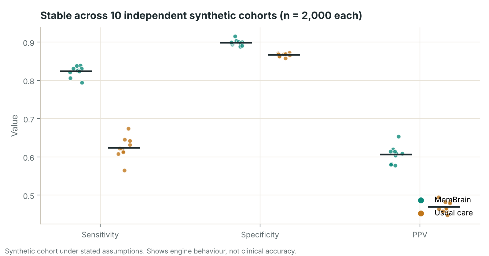
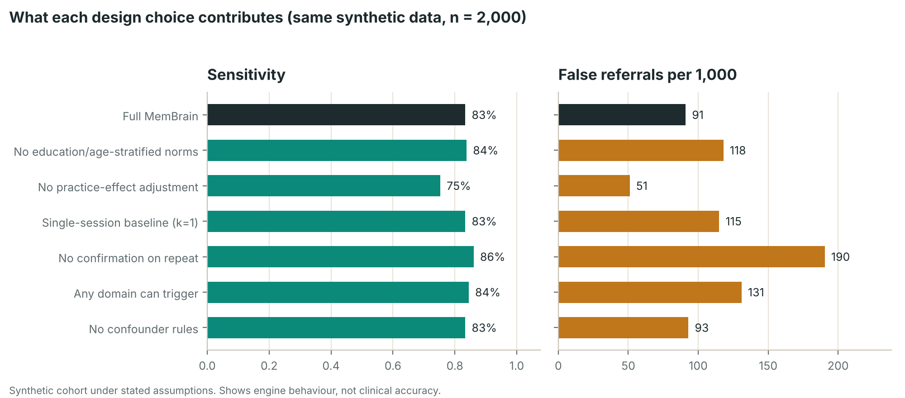
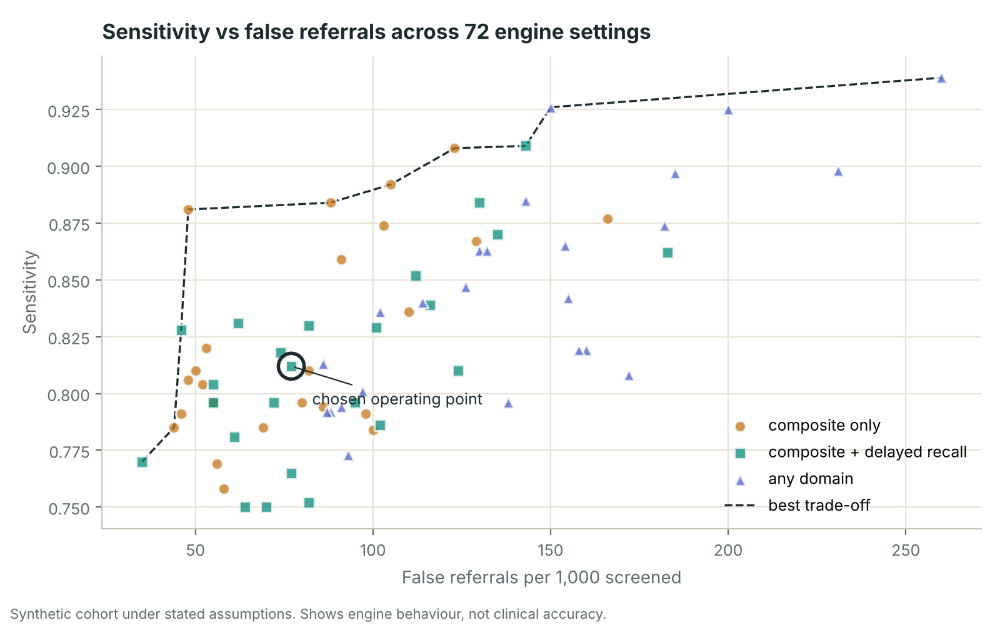
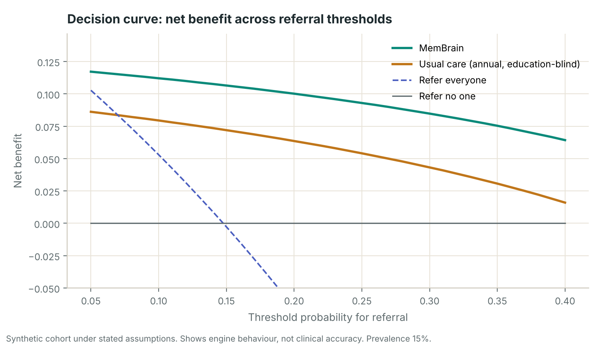
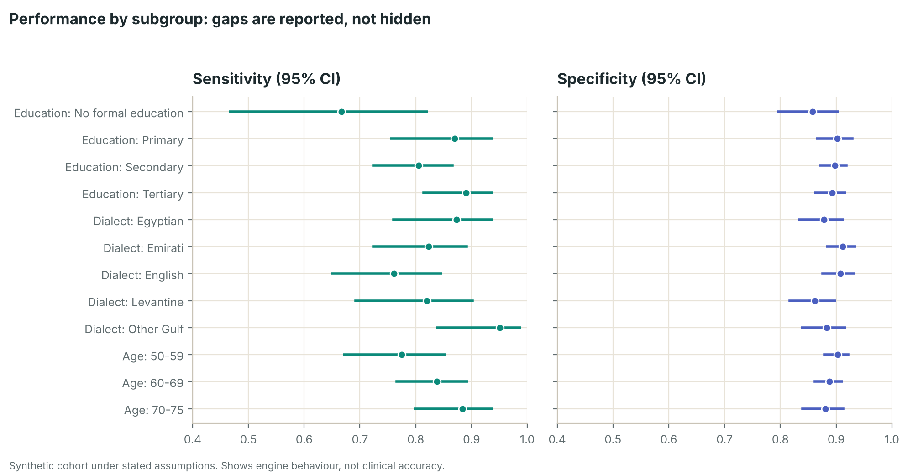

# Evidence pack

**Everything here comes from the synthetic cohort** (`membrain/simulate.py`, assumptions listed there and in `ASSUMPTIONS_LIMITATIONS.md`). It shows how the engine behaves and which design choices do the work. It is **not** evidence of clinical accuracy; that comes from Phase A and Phase B.

Reproduce it with `python scripts/evidence_pack.py` (about 1–2 minutes on 2 cores). Outputs: `docs/evidence/*.png` and `evidence_summary.json`. It is also shown in the demo's Validation tab.

## 1. Stability across cohorts

The full pipeline was run on 10 independent synthetic cohorts of 2,000 people each.

| Metric | MemBrain, mean ± SD (range) | Usual care, mean ± SD |
|---|---|---|
| Sensitivity | 82% ± 1.4 (79%–84%) | 62% ± 2.8 |
| Specificity | 90% ± 0.7 | 87% ± 0.4 |
| PPV | 61% ± 2.3 | 47% ± 1.4 |
| Referrals per confirmed finding | 1.65 ± 0.06 | 2.13 ± 0.07 |
| False referrals per 1,000 screened | 85 ± 6 | – |
| Meaningful change detected (sens / spec) | 59% / 95% | – |
| Test–retest ICC | 0.85 ± 0.01 | – |
| False positives at entry, no formal education | **4%** | 42% (single cutoff) |
| Sensitivity, no formal education | 84% (range 72%–96%) | – |

**Correction to earlier drafts.** The 67% sensitivity for people with no formal education came from a single cohort (seed 7). Across 10 cohorts the mean is 84%, but it varies widely, because this subgroup has few impaired people. The honest conclusion is that **small-subgroup estimates are unstable**, and Phase A must enrich this stratum. It is not evidence of a confirmed gap.

## 2. What each design choice contributes (ablation)

Same 2,000 people and sessions; one component switched off at a time.

| Engine | Sensitivity | Specificity | False referrals /1,000 | vs full | Change detected |
|---|---|---|---|---|---|
| Full MemBrain | 83% | 89% | 91 | – | 64% |
| No education/age-stratified norms | 84% | 86% | 118 | +30% | 64% |
| No practice-effect adjustment | 75% | 94% | 51 | -44% | 28% |
| Single-session baseline (k=1) | 83% | 86% | 115 | +26% | 53% |
| No confirmation on repeat | 86% | 78% | 190 | +109% | 68% |
| Any domain can trigger | 84% | 85% | 131 | +44% | 65% |
| No confounder rules | 83% | 89% | 93 | +2% | – |

- **Confirmation on repeat** is the biggest single safeguard. Without it, false referrals roughly double.
- **Education- and age-stratified norms** cut false referrals by about a quarter overall, and by about 90% at entry for people with no formal education.
- **The multi-session baseline** and **trigger restriction** (composite plus delayed recall only) each prevent about 25–45% more false referrals.
- **Practice-effect adjustment** raises sensitivity (otherwise practice gains hide real decline) and roughly doubles change detection, at the cost of more referrals.
- **Confounder rules** change little in this simulation, because confirmation already absorbs one-off dips. They matter for the explanation shown to the clinician and for the mental-health pathway rather than for the counts. We say so rather than over-claim.

## 3. Operating point: 72 settings, and an over-fitting check

We swept the change threshold (RCI ≤ −1.28, −1.645, −1.96 or −2.33), which signals can trigger an alert, the entry cutoff (z ≤ −1.0, −1.5 or −2.0) and the baseline length (2 or 3 sessions). On a single cohort, several stricter settings looked strictly better than our default. We then re-tested the best two on 5 fresh cohorts:

| Setting | Sensitivity | False referrals /1,000 | PPV | Change detected |
|---|---|---|---|---|
| Chosen default: RCI ≤ -1.645, composite + delayed recall, entry z ≤ -1.5, baseline 2 | 83% | 91 | 59% | 60% |
| Candidate 1: RCI ≤ -1.96, composite only, entry z ≤ -2.0, baseline 3 | 78% | 47 | 73% | 38% |
| Candidate 2: RCI ≤ -1.96, composite + delayed recall, entry z ≤ -2.0, baseline 3 | 76% | 51 | 71% | 40% |

The stricter settings halve false referrals, but they lose sensitivity and, above all, detect far less change over time. **We keep the pre-specified default**, because MemBrain's purpose is earlier detection of change. The stricter setting is documented as the option for clinics with very limited review capacity. In line with the clinical team's principle that thresholds follow evidence, not capacity, the final operating point is fixed on Phase A data and pre-registered before Phase B.

## 4. Decision curve

Net benefit (Vickers and Elkin) at prevalence 15%. MemBrain is above usual care, "refer everyone" and "refer no one" across referral thresholds from 5% to 40%.

## 5. PPV by deployment setting

| Setting | Prevalence | MemBrain PPV | Usual care PPV |
|---|---|---|---|
| Community outreach | 5% | 30% | 20% |
| Screening programme, 50–75 | 15% | 59% | 45% |
| Memory clinic referrals | 30% | 78% | 67% |

At community prevalence, most positives would be false. This is why MemBrain is deployed through programmes and clinics with clinician review, never as an open consumer test.

## 6. Subgroups

Confidence intervals are wide for small strata (no formal education, some dialects). Each threshold will be checked against a pre-agreed minimum for every subgroup in Phase A.

## 7. Phase B sample size (preliminary)

Using the Buderer (1996), 95% CI half-width 0.07 method, with expected sensitivity 82%, specificity 90% and prevalence 15%: about **770** participants for sensitivity, and 84 for specificity. Subgroup estimates (dialect, age, education) need either this n per stratum or enrichment sampling; final sizes set with the biostatistician.
